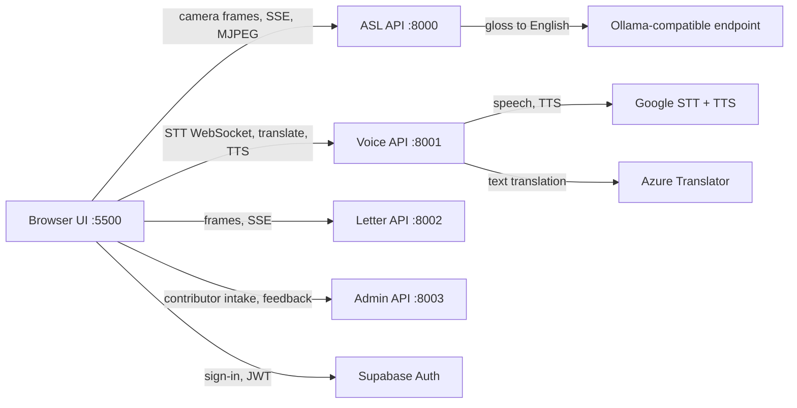
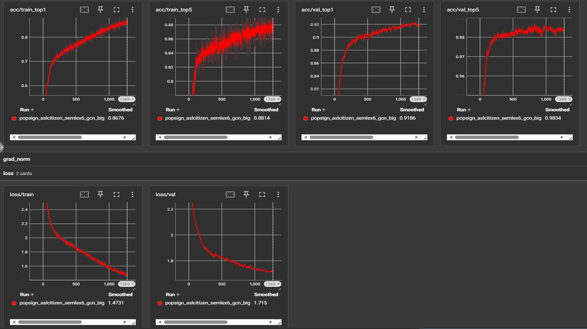

# Sign2Text — Real-Time ASL to English Captioning

Sign2Text is a web application that turns American Sign Language into readable
English captions in real time, using nothing but a normal webcam. It combines a
deep-learning sign-recognition model, live speech-to-text, and fingerspelling
recognition behind a single browser interface, so a Deaf or hard-of-hearing user
and a hearing user can hold a two-way conversation on one screen.

> **This is a portfolio repository.** It is a curated, source-available subset of
> a larger private team project, published so the code can be reviewed. It is
> not a complete production deployment. Some trained model weights, private
> datasets, production credentials, and team-owned modules are intentionally
> excluded. See [Known public-release limitations](#known-public-release-limitations).

---

## The problem this solves

Roughly 70 million people worldwide use a sign language as their first language.
Most everyday conversations with non-signers still depend on a human
interpreter being booked in advance, or on typing back and forth on a phone.

Existing automatic tools tend to fall short in one of two ways: they recognise
only static handshapes (fingerspelling), which is far too slow for real
conversation, or they require studio conditions that do not survive a laptop
webcam in a badly lit room.

Sign2Text approaches this as a full product rather than a model demo:

- It recognises **whole signs**, not just letters, so normal signing speed works.
- It runs on an **ordinary webcam** in a browser, with no special hardware.
- It handles the **other direction too** — speech-to-text for the hearing
  participant — so one screen serves both people.
- It converts recognised sign glosses into **natural English sentences**, because
  ASL grammar is not English word order and a raw gloss stream is hard to read.

---

## Demo

The video below demonstrates the completed Sign2Text application, including
real-time ASL recognition, English caption generation, Voice mode, and
fingerspelling recognition.

### Application Demo

https://github.com/user-attachments/assets/ea1ec8eb-1e61-423a-afbe-ed9c862cf916


## Main features

- **Three input modes** in one interface — ASL signing, speech, and
  fingerspelling — sharing a single caption surface and session.
- **Real-time recognition** from browser camera frames, with a live skeleton
  overlay showing what the model is tracking.
- **Automatic sign segmentation** that decides where one sign ends and the next
  begins in a continuous stream, instead of requiring the user to pause.
- **Gloss-to-English conversion** through a local or remote language model, so
  output reads as sentences rather than word lists.
- **Speech-to-text** with optional translation into other languages and
  text-to-speech playback.
- **Fingerspelling recognition** that accumulates letters into words, suppresses
  accidental repeats, and detects word boundaries automatically.
- **Session management** — transcripts can be downloaded, cleared, archived to
  browser-local history, or synced to the backend when signed in.
- **Consent-gated capture.** The camera and microphone are not opened until the
  user explicitly agrees.
- **Admin dashboard** for contributor intake and public feedback, with search,
  filtering, inline editing, CSV export, and rate limiting.
- **Hardware-adaptive runtime** that selects a CUDA or CPU path automatically.

---

## Application modes

| Mode | Input | How it works |
| --- | --- | --- |
| **ASL** | Browser camera | Pose estimation → sign-boundary segmentation → CTR-GCN classification → gloss buffering → language-model conversion to English |
| **Voice** | Browser microphone | WebSocket audio streaming → Google Speech-to-Text → optional Azure translation → Google Text-to-Speech |
| **Letter** | Browser camera | MediaPipe Hands → MLP handshape classifier → letter accumulation with repeat suppression and word-boundary detection |

Output from any mode can be appended to the transcript, translated, spoken
aloud, downloaded, or archived into session history.

---

## System architecture



Five processes, started and supervised by `start.py`:

| Service | Port | Responsibility |
| --- | --- | --- |
| `backend/frontend_server.py` | 5500 | Routing-aware static server for the app, admin dashboard, and legal pages |
| `backend/api_server.py` | 8000 | ASL runtime — SSE events, MJPEG video, frame upload, pipeline lifecycle |
| `backend/stt_backend.py` | 8001 | Authentication, WebSocket speech-to-text, translation, text-to-speech |
| `backend/letter_server.py` | 8002 | Fingerspelling recognition |
| `backend/admin_server.py` | 8003 | Contributor intake, public feedback, admin management API |

Splitting these into separate services keeps a slow model load in the ASL
service from blocking speech transcription, and lets the CPU-only services run
even when no GPU is present.

More detail: [`docs/tech/ARCHITECTURE.md`](docs/tech/ARCHITECTURE.md) ·
[`docs/tech/API_REFERENCE.md`](docs/tech/API_REFERENCE.md)

---

## How the real-time pipeline works

The hardest part of live sign recognition is not classification — it is knowing
*when* a sign has happened. The pipeline handles this in five stages:

1. **Capture.** The browser grabs webcam frames and streams them to the ASL
   service. Frames go over a WebSocket, with an HTTP upload fallback for
   networks that block sockets.
2. **Pose estimation.** Each frame is reduced to a whole-body skeleton — 86
   keypoints covering hands, arms, and face. Working on skeletons rather than
   raw pixels makes the model far less sensitive to lighting, clothing, skin
   tone, and background.
3. **Segmentation.** A velocity-based spotter watches keypoint motion to find
   where a sign starts and stops. Signing is continuous, so this decides the
   boundaries rather than asking the user to pause between signs.
4. **Classification.** Each segment goes to the CTR-GCN model, which returns a
   ranked list of candidate glosses with confidence scores. Low-confidence
   segments are re-checked by splitting them in half, which catches cases where
   two quick signs were merged into one.
5. **Language conversion.** Accepted glosses are buffered until a sentence
   boundary is detected, then rewritten into natural English by a language
   model. ASL grammar differs from English word order, so `ME STORE GO` has to
   become "I'm going to the store."

Three different transports are used, each where it fits best: **WebSocket** for
two-way audio streaming, **Server-Sent Events** for one-way push of recognition
events, and **MJPEG** for the annotated video preview.

---

## Technology stack

| Layer | Technologies |
| --- | --- |
| **Backend** | Python 3.11, FastAPI, Uvicorn, Starlette, Pydantic |
| **Machine learning** | PyTorch, ONNX Runtime, RTMLib (RTMW pose), MediaPipe Hands, scikit-learn, NumPy |
| **Web frontend** | Vanilla ES modules, Tailwind CSS, Server-Sent Events, WebSocket, Canvas |
| **Landing site** | React 19, Vite 6, React Router, Framer Motion |
| **Data & auth** | Supabase (Postgres + Auth), SQLite fallback |
| **External services** | Google Speech-to-Text, Google Text-to-Speech, Azure Translator, Ollama |
| **Testing** | pytest, Playwright |
| **Tooling** | PowerShell, Bash, Docker, GitHub Actions |

---

## Machine-learning model

The word-recognition model is a **CTR-GCN + Conformer** operating on sequences
of 86 whole-body keypoints.

A standard graph convolution over a skeleton uses one fixed adjacency matrix —
it assumes the same joints always matter equally. **Channel-Topology Refinement
GCN** instead learns a separate adjacency per feature channel. That matters for
sign language, where the informative joint relationships change from sign to
sign: one sign is defined by the two hands relative to each other, another by a
hand relative to the face.

Input is shaped `[batch, 64 frames, 86 joints, 16 channels]`, where the 16
channels carry coordinates plus derived kinematic and bone features. Training
used heavy augmentation — rotation, scaling, temporal resampling, and spatial
and temporal masking — specifically to close the gap between clean training
recordings and real webcam conditions.

Fingerspelling uses a much smaller model: a 3×256 MLP over 42-dimensional
MediaPipe hand landmarks. A cross-signer variant subtracts the wrist position
and normalises by palm size, which makes it invariant to where the hand sits in
frame and how far the user is from the camera. I benchmarked this replacement
against the original logistic-regression classifier on an identical stratified
split and selected the MLP on the result.

The pipeline and training-framework code were written by Stepan Karapetyan; the
training runs, experiments, evaluation, and checkpoint selection that produced
the models described here were mine.

Pipeline detail: [`docs/ml/PIPELINE.md`](docs/ml/PIPELINE.md) ·
Vocabulary: [`docs/ml/SUPPORTED_SIGNS.md`](docs/ml/SUPPORTED_SIGNS.md)

---

## Verified model results

| Model | Task | Top-1 | Top-5 | Evidence |
| --- | --- | --- | --- | --- |
| `curated600_resume2` | 604-class isolated signs | **92.53%** | **98.48%** | Checkpoint metrics, epoch 181 |
| `popsign_aslcitizen_semlex6` | 347-class isolated signs | **92.47%** | not recorded | Checkpoint `best_val_acc`, epoch 1119 |
| `MLP_256x3` | 24-class fingerspelling | **99.56%** | — | `EVAL_NOTES.md` |
| `MLP_256x3_centered` | 24-class fingerspelling, cross-signer | **99.68%** | — | `eval.md` |

Every number above was recovered from a stored artifact — either the metrics
dictionary saved inside the checkpoint file itself, or an evaluation note
recording the dataset, split, and random seed. None were re-run or estimated.

Two honest caveats, both explained in [`MODEL_RESULTS.md`](MODEL_RESULTS.md):

- **Word and letter results are not comparable.** They measure different tasks
  (604 dynamic sign classes from video vs. 24 static handshapes from one frame)
  on different validation sets. They must never be averaged into a single
  headline figure.
- **One internal figure was excluded.** A note in the project claimed a
  different accuracy for the word model, but no supporting artifact exists
  anywhere in the repository, so it is documented as unverified and is not used
  as a result. No confusion-matrix exports or per-class diagnostic files were
  retained, and none are claimed.

I ran the training jobs these numbers come from, monitored the runs, compared
checkpoints, and verified every figure above against its stored artifact.

---
### Model Training

I trained the published model variants, monitored optimization, and captured the
dashboard below. It shows the progression of training and validation Top-1
accuracy, Top-5 accuracy, and loss throughout a run.

The image is a **screenshot of a TensorBoard dashboard**. TensorBoard smooths
displayed curves by default, so values read off it are not the same as exact
best-checkpoint metrics, and the raw event files are not published. The headline
numbers in the table above come from checkpoint-embedded metrics and written
evaluation notes, not from this image.

<p align="center">
  
</p>

## Installation

**Requirements:** Python 3.11, Node.js 20+, and a webcam. An NVIDIA GPU is
optional — the runtime falls back to CPU automatically.

```powershell
# Windows
git clone <this-repository>
cd Sign2Text
.\setup.ps1
```

```bash
# Linux / macOS
git clone <this-repository>
cd Sign2Text
./setup.sh
```

`setup.ps1` creates a virtual environment, installs the pinned dependencies for
your hardware profile, and builds the landing site. To force a profile:

```powershell
.\setup.ps1 -Profile cpu     # or: auto (default), cuda
```

Full guide: [`docs/INSTALLATION_GUIDE.md`](docs/INSTALLATION_GUIDE.md) ·
[`docs/QUICK_START.md`](docs/QUICK_START.md)

---

## Configuration

Copy the template and fill in the placeholders:

```bash
cp .env.example .env
```

Every setting is optional except those needed by the modes you actually want.
The services start regardless and report their own degraded capabilities through
`GET /runtime`, so you can run the app with no credentials at all and simply not
use Voice mode.

| Setting | Needed for |
| --- | --- |
| `GOOGLE_STT_CREDENTIALS`, `GOOGLE_TTS_CREDENTIALS` | Voice mode speech-to-text and speech playback |
| `AZURE_TRANSLATOR_KEY`, `AZURE_TRANSLATOR_REGION` | Translating captions into other languages |
| `SUPABASE_URL`, `SUPABASE_ANON_KEY`, `SUPABASE_ENABLED` | Sign-in and cloud transcript sync (optional) |
| `ADMIN_ACCESS_TOKEN` | Admin dashboard (minimum 16 characters) |
| `OUR_MODEL_CHECKPOINT`, `OUR_MODEL_CONFIG`, `OUR_MODEL_VOCAB` | ASL mode — requires your own trained checkpoint |

**Never commit your `.env`.** It is listed in `.gitignore`, but check
`git status` before committing anyway.

Reference: [`docs/tech/CONFIGURATION.md`](docs/tech/CONFIGURATION.md)

---

## Running the landing page

The landing site is a standalone React application and can run on its own:

```bash
cd landing
npm ci
npm run dev        # development server with hot reload
npm run build      # production build into landing/dist/
npm run preview    # serve the production build locally
```

When you run the full application, `start.py` serves the built landing site at
`http://127.0.0.1:5500/`.

---

## Running the main application

```powershell
# Windows
.\start.ps1
```

```bash
# Linux / macOS
./start.sh
```

Then open **http://127.0.0.1:5500/index.html**.

This starts all five services. To force a hardware profile:

```powershell
.\start.ps1 -Profile cpu
```

To check what the runtime actually detected:

```powershell
Invoke-RestMethod http://127.0.0.1:8000/runtime | Format-List
```

**What runs from this repository:** Voice mode, Letter mode, the admin
dashboard, and the landing site all work. **ASL mode does not** — it needs the
recognition pipeline and a trained checkpoint, both of which are excluded. See
[Known public-release limitations](#known-public-release-limitations).

---

## Testing

```powershell
# The scope CI enforces
python -m pytest -m "not requires_private_assets and not legacy_auth"

python -m pytest        # the complete suite, including what CI deselects
npx playwright test     # end-to-end browser tests
```

The suite is 22 pytest modules and 7 Playwright specs, roughly 8,000 lines. It
covers runtime configuration and hardware profile resolution, launcher
behaviour, the ASL event bus and transport status, inference helpers,
letter-recognition endpoints, per-service authentication guards, translation and
text-to-speech paths, the Supabase client and repository layers, the
SQLite-to-Supabase migration, and admin CRUD including rate limiting and
honeypot handling.

**Current state: 288 passing, 0 failing** in the blocking CI scope.

CI enforces every test that applies to the published source. 41 tests are
deselected, each carrying a written reason at the test itself, under two
markers:

- **`requires_private_assets` (26)** — needs a camera, excluded model weights, a
  teammate-owned module, or a private deployment script. These drive the real
  app through its startup lifespan, so they cannot pass on a CI runner by
  design.
- **`legacy_auth` (15)** — asserts the cookie-backed Google OAuth session
  contract that Supabase JWT replaced. Satisfying them would mean re-adding a
  development fallback session secret, which the sanitized build deliberately
  removes.

Nothing is deselected merely for failing, and no assertion has been weakened.
The complete suite — including both marked groups — still runs in the
[diagnostic workflow](.github/workflows/diagnostic-tests.yml).

Root causes and the repair plan are in
[`docs/TESTING_STATUS.md`](docs/TESTING_STATUS.md).

---

## Privacy and security

Accessibility software handles unusually sensitive input — a camera pointed at
someone's face and hands, and a microphone in their room. This was treated as a
design constraint rather than a compliance afterthought.

- **Explicit consent** is required before the camera or microphone is opened.
  No frame or audio sample leaves the browser before the user agrees.
- **No recording by default.** Frames are processed and discarded. Transcripts
  live in browser-local storage; syncing to the backend is opt-in and requires
  sign-in.
- **Authentication on every protected route**, validated per request as a
  Supabase JWT.
- **Admin routes use a separate token** and refuse to serve at all — returning
  `503`, not `401` — when that token is missing or matches a known placeholder
  value, so a misconfigured deployment fails closed.
- **No credentials, datasets, or user data** are present anywhere in this
  repository.

[Privacy Policy](docs/PRIVACY_POLICY.md) · [Terms of Use](docs/TERMS_OF_USE.md)

---

## Known public-release limitations

This repository is deliberately incomplete. Being precise about what is missing
matters more than looking complete.

| Not included | Reason |
| --- | --- |
| ASL recognition pipeline (`backend/our_pipeline/`) | Authored by a teammate. Not mine to publish. A documented stub keeps the imports working and raises a clear error if called. |
| Supabase auth module, letter-model loader, mobile app | Also teammate-authored. Independently written, interface-compatible replacements are provided for the two modules the services need to import. |
| Trained model weights (`.pt`, `.ckpt`, `.pkl`) | About 185 MB, trained on research datasets (ASL Citizen, Sem-Lex, PopSign) whose redistribution terms are unresolved. Architecture, hyperparameters, label maps, and results are published instead. |
| Training and keypoint-extraction scripts | Maintained privately. |
| Datasets and collected clips | Contain third-party and contributor data. |
| Credentials, service-account files, admin database | Never publishable. |
| Deployment runbooks and internal roadmaps | Operational material with no review value, and some of it describes live infrastructure. |

**What this means in practice:** ASL mode will not run without supplying your
own pipeline implementation and checkpoint. Everything else — Voice mode, Letter
mode, admin, the landing site, and the test suite — runs from this repository as
published.

Files marked "public replacement" in their header are **not** stripped-down
copies of the private implementations. They were written independently to
satisfy the same interface, and they say so at the top of the file.

---

## My contributions

I worked across the full product surface as well as the machine-learning side of
the project:

- **Full-stack development** — the browser application, four of the Python
  services, the runtime configuration and launcher tooling, and the landing site.
- **Admin dashboard** — the token-guarded lead and feedback management surface.
- **Testing and CI** — the pytest and Playwright suites and the GitHub Actions
  workflows.
- **Machine-learning training and evaluation** — I ran the training jobs,
  monitored training and validation metrics, compared and selected checkpoints,
  evaluated the resulting models, and verified every published result against its
  source artifact.
- **Documentation and public-release preparation** — including this sanitized
  portfolio repository.

An important distinction: the ASL recognition pipeline and the ML
training-framework code were written by Stepan Karapetyan. **Training the models
on that framework — the experiments, the runs, the monitoring, the checkpoint
comparison and selection, and the evaluation — was my work.** Building a training
framework and using it to produce trained models are two different jobs, and this
repository credits them separately.

A detailed, evidence-backed breakdown — including which parts were collaborative
and which were built by teammates — is in
[`MY_CONTRIBUTIONS.md`](MY_CONTRIBUTIONS.md).

---

## Team acknowledgements

Sign2Text was a four-person team project. This repository contains only my own
work, but the application it describes was not built alone.

| Contributor | Contribution |
| --- | --- |
| **Koko Jamgotchian** | Full-stack development, backend services, web frontend, admin dashboard, landing site, runtime and launcher tooling, automated testing and CI, documentation, and the machine-learning work: training runs, experiments, evaluation, checkpoint selection, and results analysis |
| **Stepan Karapetyan** | ASL recognition pipeline implementation, ML training-framework and architecture code, Supabase auth module, letter model loader, mobile application |
| **Christopher Casas** | Mobile application |
| **armbotzzz** | Project contributions |

Full attribution: [`THIRD_PARTY_ATTRIBUTION.md`](THIRD_PARTY_ATTRIBUTION.md)

---

## Third-party attribution

This project builds on open-source software, published research architectures,
and third-party research datasets. Dependencies, licences, dataset sources, and
academic citations are listed in
[`THIRD_PARTY_ATTRIBUTION.md`](THIRD_PARTY_ATTRIBUTION.md).

---

## Copyright and usage notice

**Copyright © 2026 Sign2Text contributors. All rights reserved.**

This repository is provided for portfolio review, educational demonstration, and
evaluation purposes. No permission is granted to copy, modify, redistribute,
sublicense, or use the source code commercially without written permission from
the applicable copyright holders.

It is source-available, not open-source. Full terms: [`COPYRIGHT.md`](COPYRIGHT.md)
