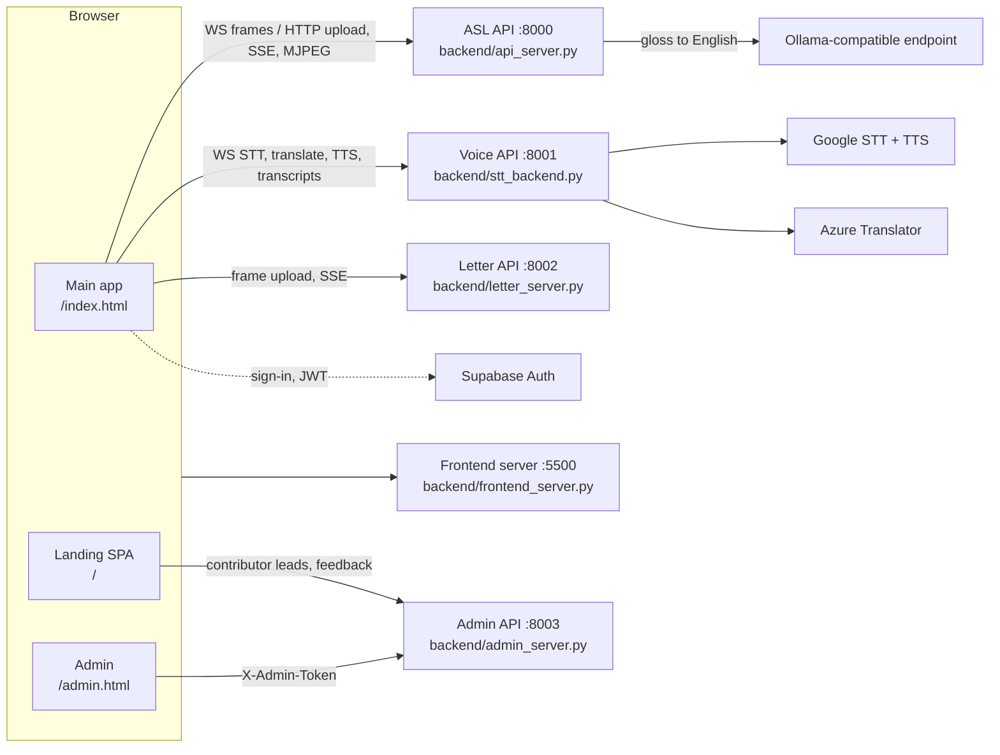
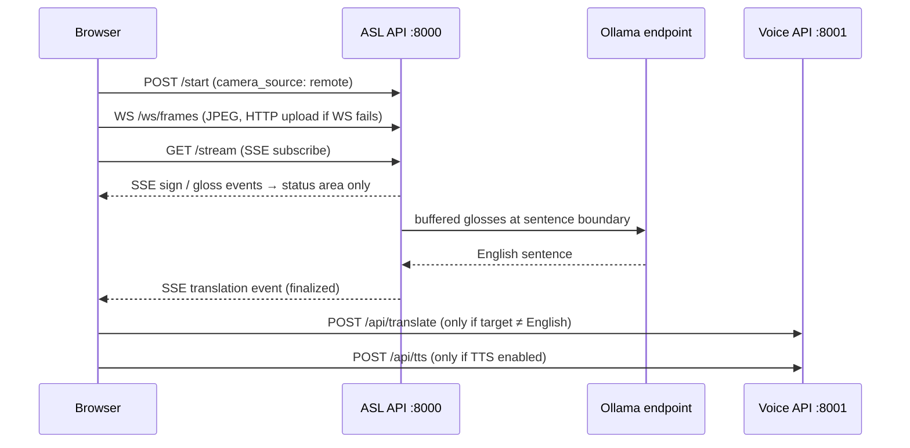

# Sign2Text Project Overview

**Authoritative technical overview of this public repository.**

This document describes Sign2Text as it exists in the published source tree. Every
claim below was checked against code, configuration, tests, or a stored artifact in
this repository. Where the public repository cannot do something — because a model
weight file, a dataset, a teammate-owned module, or a third-party credential is not
included — this document says so plainly rather than describing the private project
as though it were published here.

If a statement in another document conflicts with this one, prefer the evidence
cited here and see [Known documentation conflicts](#22-known-documentation-conflicts).

---

## 1. Executive summary

Sign2Text turns American Sign Language into readable English captions in real time
using an ordinary webcam, and transcribes speech in the other direction, so a Deaf or
hard-of-hearing user and a hearing user can hold a conversation on one screen.

The system is a five-process web application: a static frontend server, three
recognition/media services (ASL, Voice, Letter), and an admin service, coordinated by
a single launcher and fronted by one browser interface with a shared caption and
session model.

| | |
| --- | --- |
| **What this repository is** | A curated, sanitized subset of a four-person team project, published for portfolio review |
| **What it is not** | A complete product release, a deployable production system, or a hosted demo |
| **Licence position** | Source-available, all rights reserved — **not** open-source ([`COPYRIGHT.md`](../COPYRIGHT.md)) |
| **Runs from a clean clone** | Landing site, admin service, frontend server, and the 288-test suite |
| **Does not run from a clean clone** | ASL mode and Letter mode (excluded model weights/modules); Voice mode needs third-party credentials |
| **Blocking test suite** | 288 passed, 0 failed, 41 deselected — reproduced during this audit |

---

## 2. Problem and accessibility goal

Most everyday conversations between signers and non-signers still depend on booking a
human interpreter or typing back and forth on a phone. Automatic tools tend to fail in
one of two ways: they recognise only static handshapes (fingerspelling), which is far
slower than natural signing, or they need capture conditions that a laptop webcam in a
poorly lit room will never meet.

Sign2Text was built as a product rather than a model demo, around four goals:

- **Recognise whole signs**, not just letters, so natural signing speed works.
- **Run on an ordinary webcam** in a browser, with no special hardware.
- **Serve both directions** — speech-to-text for the hearing participant on the same
  screen.
- **Produce English sentences**, not raw gloss lists. ASL grammar is not English word
  order, so `ME STORE GO` has to become "I'm going to the store."

The public repository demonstrates the engineering behind these goals. It does not
ship the trained weights that would let a reviewer reproduce live recognition.

---

## 3. Public repository scope

Sign2Text was built by a four-person team. This repository contains the subset that
one contributor authored and is able to publish. Understanding the boundary matters
for reading everything that follows.

### 3.1 What is included

| Included | Notes |
| --- | --- |
| All five service implementations | ASL, Voice, Letter, Admin, frontend server |
| The browser application | [`frontend/web/`](../frontend/web/) — ~2,900-line three-mode state machine |
| The React landing site | [`landing/`](../landing/) — builds and runs |
| Launcher, runtime config, reverse proxy | [`start.py`](../start.py), [`backend/runtime_config.py`](../backend/runtime_config.py), [`tunnel_proxy.py`](../tunnel_proxy.py) |
| The gloss-to-English normalization layer | [`backend/new_Inference.py`](../backend/new_Inference.py) |
| Model **metadata** | Training configs, vocabularies, label orders, evaluation notes |
| The test suite and CI | 22 pytest modules, 7 Playwright specs, 2 workflows |

### 3.2 What is excluded, and the consequence

| Excluded | Reason | Consequence for this repository |
| --- | --- | --- |
| Trained model weights (`*.pt`, `*.ckpt`, `*.pkl`, ~185 MB) | Trained on research-licensed datasets (ASL Citizen, Sem-Lex, PopSign) whose redistribution terms are unresolved | ASL mode cannot classify signs; [`start.py`](../start.py) aborts at startup |
| `backend/our_pipeline/` implementation | Teammate-authored (Stepan Karapetyan) | The alternative `ASL_PIPELINE=ours` path is unavailable |
| `backend/letter_mlp.py` | Teammate-authored | **Letter mode cannot start** — see [§5.3](#53-letter-mode) |
| `backend/data/hand_signals.csv` | Dataset of undocumented provenance | The legacy logistic-regression fallback also cannot train |
| Mobile application (`frontend/mobile/`) | Primarily teammate-authored | The WebRTC `/offer` endpoint has no published client |
| `setup_runpod.sh` | Private GPU-host provisioning | The [`Dockerfile`](../Dockerfile) references it and will not build as published |
| Credentials, `.env`, service accounts, admin database | Never publishable | Voice mode and Supabase features need operator-supplied values |
| Training and keypoint-extraction scripts | Maintained privately | Results cannot be reproduced from this repository |

### 3.3 Public replacement modules

Two teammate-authored modules were re-implemented independently so the published
services stay importable and the test suite stays runnable. Each says so in its file
header. They are **not** stripped-down copies of the private implementations.

| Module | Role |
| --- | --- |
| [`backend/auth_supabase.py`](../backend/auth_supabase.py) | Supabase JWT guards — `require_user`, `get_user_from_ws`, `verify_jwt` |
| [`backend/our_pipeline/adapter.py`](../backend/our_pipeline/adapter.py) | Documents the pipeline interface and raises `PipelineNotAvailableError` if constructed |

A third excluded module, `backend/letter_mlp.py`, has **no** public replacement. This
is why Letter mode does not start.

---

## 4. Main user experience

One browser page hosts all three input modes behind a shared caption surface, so
switching modes never loses the conversation.

- **Consent first.** Neither camera nor microphone opens until the user accepts the
  consent modal. The decision is stored as `consentAccepted` in `localStorage` and
  checked before any pipeline starts.
- **One caption surface.** ASL, Voice, and Letter all write finalized text into the
  same transcript. Live, unstable recognition output stays in a separate status area
  under the camera and is never translated or spoken.
- **Per-mode language selection.** Source language is fixed per mode; the target
  language is chosen from `en`, `es`, `ar`, `hy` and persisted per user, per mode.
- **Session management.** Transcripts can be downloaded, cleared, or archived into
  browser-local history. "New Chat" archives non-empty session text and starts a blank
  session without changing modes.
- **Optional cloud sync.** When signed in, history merges with backend transcript rows
  and unsynced local entries are migrated on a best-effort basis. If transcript storage
  is unavailable the endpoints return `503` and the local path continues to work.

---

## 5. Application modes

### 5.1 ASL mode

| | |
| --- | --- |
| **Input** | Browser camera frames (JPEG) |
| **Transport** | WebSocket `/ws/frames` preferred; automatic HTTP `POST /upload_frame` fallback after a 1.5 s connect timeout |
| **Processing** | Pose estimation → sign-boundary segmentation → classification → gloss buffering → sentence-boundary detection → language-model rewrite |
| **Output** | SSE `translation` events carrying finalized English |
| **Service** | [`backend/api_server.py`](../backend/api_server.py) on port 8000 |
| **Runs publicly?** | **No** — requires a trained checkpoint that is not published |

Only finalized English from the SSE `translation` event reaches the caption surface.
If the target language is English it is appended directly; otherwise the frontend calls
the Voice service's `POST /api/translate` and appends the translated result, falling
back to the English text if translation fails. Text-to-speech, when enabled, speaks only
the finalized output. A session-generation guard prevents stale asynchronous
translate/TTS callbacks from leaking into a newly started session.

Preview behaviour depends on deployment mode: in direct (non-proxy) remote mode the
browser overlays the backend's annotated MJPEG stream from `GET /video_feed`; behind
the reverse proxy the backend skips preview rendering and the browser's own `<video>`
element is the preview.

### 5.2 Voice mode

| | |
| --- | --- |
| **Input** | Browser microphone |
| **Transport** | WebSocket `/ws/stt` (token passed as `?token=` because browsers cannot set headers on WebSocket/EventSource) |
| **Processing** | Google Speech-to-Text → optional Azure Translator → optional Google Text-to-Speech |
| **Service** | [`backend/stt_backend.py`](../backend/stt_backend.py) on port 8001 |
| **Runs publicly?** | **Code runs; transcription does not** without Google/Azure credentials |

The Voice service is also the shared utility service: ASL and Letter modes reuse its
`POST /api/translate` and `POST /api/tts` endpoints rather than duplicating the
integrations.

### 5.3 Letter mode

| | |
| --- | --- |
| **Input** | Browser camera frames (JPEG) |
| **Transport** | HTTP `POST /upload_frame`; SSE `GET /stream` for events |
| **Processing** | MediaPipe Hands landmarks → pretrained `MLP_256x3` handshape classifier → letter acceptance → word assembly |
| **Output** | SSE events including letter detection, acceptance, and `word_completed` |
| **Service** | [`backend/letter_server.py`](../backend/letter_server.py) on port 8002 |
| **Runs publicly?** | **No** — `POST /start` fails on a missing module |

The service process starts and `GET /health` responds, but `LetterPipeline.start()`
imports `backend.letter_mlp`, which is not published, so `POST /start` raises before the
pipeline initialises. The older logistic-regression trainer still exists in the file as
legacy code but is no longer called, and its training CSV is excluded as well. Two tests
are marked `requires_private_assets` for exactly this reason.

Acceptance logic that *is* published and verifiable: a candidate letter must be stable
across frames (or clear a 0.85 fast-accept confidence bar), a duplicate-letter lock
blocks immediate repeats until a release condition is met, and roughly two seconds
without a detected hand closes the current word.

### 5.4 Admin dashboard

| | |
| --- | --- |
| **Surface** | [`frontend/web/admin.html`](../frontend/web/admin.html) — single file, ~3,900 lines, inline JavaScript |
| **Service** | [`backend/admin_server.py`](../backend/admin_server.py) on port 8003 |
| **Storage** | SQLite at `data/admin.sqlite3` by default; Supabase when `SUPABASE_ENABLED` and `SUPABASE_USE_FOR_ADMIN` are both true, with automatic SQLite fallback if Supabase init fails |
| **Runs publicly?** | **Yes**, with an operator-supplied `ADMIN_ACCESS_TOKEN` |

Provides two views (Contributor Leads and Feedback) with summary cards, search and
status filtering, inline status/notes editing, CSV export, single and bulk deletion,
and explicit loading, empty, filtered-empty, and error states. The admin token is held
in `sessionStorage`; the backend URL comes from generated runtime config.

### 5.5 Landing site

| | |
| --- | --- |
| **Stack** | React 19, React Router 7, Vite 6, Framer Motion |
| **Routes** | `/`, `/about`, `/contribute` |
| **Runs publicly?** | **Yes** — `npm ci && npm run build` verified during this audit |

The Home page carries an optional public feedback form; the Contribute page presents
the contributor programme as planned and collects email addresses for a waitlist. Both
post to the admin service.

The landing app resolves backend URLs from build-time
[`landing/src/config.js`](../landing/src/config.js), **not** from the generated
`runtime-config.js` the main app uses. Development builds target
`http://127.0.0.1:5500/index.html` and `http://127.0.0.1:8003`; production builds target
`/index.html` and `/admin-api`, so a current build works behind the proxy or a tunnel.
A stale `landing/dist` will not pick up config changes — rebuild after editing.

---

## 6. System architecture



Three design decisions are worth calling out:

1. **Separate processes per responsibility.** A slow ASL model load cannot block speech
   transcription, and the CPU-only services keep running on machines with no GPU.
2. **The browser discovers endpoints at runtime.** [`start.py`](../start.py) writes
   `frontend/web/runtime-config.js` from resolved settings, so nothing is hardcoded and
   the same build works on localhost, behind a proxy, or through a tunnel.
3. **Transport chosen per job.** WebSocket for bidirectional streams, Server-Sent
   Events for one-way push, MJPEG for annotated video.

Optionally, [`tunnel_proxy.py`](../tunnel_proxy.py) consolidates everything onto a
single port (8080) under path prefixes `/asl-api`, `/voice-api`, `/letter-api`,
`/admin-api`, plus the ASL frame and Voice STT WebSockets.

---

## 7. Service breakdown

| Service | Default port | Entry point | Responsibility |
| --- | --- | --- | --- |
| Frontend | 5500 | [`backend/frontend_server.py`](../backend/frontend_server.py) | Routing-aware static server for landing, app, admin, legal pages |
| ASL | 8000 | [`backend/api_server.py`](../backend/api_server.py) | Pipeline lifecycle, SSE, MJPEG, frame ingest, WebRTC signalling, runtime diagnostics |
| Voice | 8001 | [`backend/stt_backend.py`](../backend/stt_backend.py) | Auth identity, WebSocket STT, translation, TTS, transcript sync |
| Letter | 8002 | [`backend/letter_server.py`](../backend/letter_server.py) | Fingerspelling recognition and word assembly |
| Admin | 8003 | [`backend/admin_server.py`](../backend/admin_server.py) | Public intake, public feedback, token-guarded admin API |
| Proxy *(optional)* | 8080 | [`tunnel_proxy.py`](../tunnel_proxy.py) | Single-port reverse proxy for proxy/tunnel deployments |

All ports, bind hosts, and public URLs are overridable through environment variables
resolved by [`backend/runtime_config.py`](../backend/runtime_config.py).

### Endpoints by service

| Service | Endpoints |
| --- | --- |
| **ASL** | `POST /offer` · `POST /start` · `POST /stop` · `GET /status` · `GET /runtime` · `GET /stream` · `GET /video_feed` · `WS /ws/frames` · `POST /upload_frame` · `POST /manual_sign` · `POST /threshold` · `POST /clear` · `POST /reset` · `GET /` |
| **Voice** | `GET /auth/me` · `POST /auth/logout` · `POST /api/translate` · `POST /api/tts` *(mounted from `tts_backend.py`)* · `POST /api/transcripts` · `GET /api/transcripts` · `DELETE /api/transcripts/{id}` · `DELETE /api/transcripts` · `WS /ws/stt` · `GET /health` · `GET /` |
| **Letter** | `POST /start` · `POST /stop` · `GET /status` · `POST /upload_frame` · `GET /stream` · `GET /health` · `GET /` |
| **Admin** | `POST /api/public/contributor-leads` · `POST /api/public/feedback` · `GET /api/admin/stats` · `GET /api/admin/contributor-leads` · `GET /api/admin/contributor-leads/export` · `PATCH /api/admin/contributor-leads/{id}` · `DELETE /api/admin/contributor-leads/{id}` · `DELETE /api/admin/contributor-leads` · `GET /api/admin/feedback` · `GET /api/admin/feedback/export` · `GET /health` · `GET /` |

`POST /offer` is WebRTC signalling for the mobile client. That client is not published,
so the endpoint has no consumer in this repository.

Full route documentation: [`tech/API_REFERENCE.md`](tech/API_REFERENCE.md).

---

## 8. Real-time data flow



Three transports, each where it fits:

| Transport | Used for | Notes |
| --- | --- | --- |
| **WebSocket** | Camera frames to ASL; microphone audio to Voice | Frames fall back to HTTP POST when a proxy blocks upgrades |
| **Server-Sent Events** | Recognition events from ASL and Letter | One-way push; browser reconnects automatically |
| **MJPEG** | Annotated video preview | Direct remote mode only; skipped behind the proxy |

An event-bus replay allowlist deliberately excludes append-style events such as
`translation`, so a reconnecting client does not receive duplicate transcript entries.
When `KEYPOINTS_STREAM_ENABLED` is set, a `keypoints` SSE event also feeds a skeleton
overlay in the browser.

---

## 9. Machine-learning pipeline

The repository contains **two** ASL recognition paths, selected by the `ASL_PIPELINE`
environment variable. They use different pose front-ends, different tensor shapes, and
different model architectures — a distinction that other documents blur, and that
matters because only one of them has its code published.

| | `ASL_PIPELINE=friend` *(default)* | `ASL_PIPELINE=ours` |
| --- | --- | --- |
| Pose front-end | RTMW whole-body via `rtmlib` | MediaPipe, `mediapipe86` graph layout |
| Keypoints | **133** (COCO-WholeBody) | **86** |
| Per-joint channels | 7 | 16 (coordinates + kinematic + bone features) |
| Sequence length | up to 128 frames | 64 frames |
| Architecture | CTR-GCN + Transformer encoder (`d_model` 256, 8 heads, 4 layers, FFN 768, CLS pooling) | CTR-GCN (4 parallel body/hand/face streams) + 4 Conformer blocks |
| Checkpoint | `popsign_aslcitizen_semlex6_gcn_big` (347 classes) | `curated600_resume2` (600-class head) |
| Recognition code | **Published** — [`backend/new_Inference.py`](../backend/new_Inference.py) | **Not published** — teammate-authored |
| Weights | Not published | Not published |

**Channel-Topology Refinement GCN (CTR-GCN)** is common to both. A standard graph
convolution over a skeleton uses one fixed adjacency matrix, assuming the same joint
relationships always matter. CTR-GCN learns a separate topology per feature channel,
which suits sign language: one sign is defined by the two hands relative to each other,
another by a hand relative to the face.

The runtime stages, as implemented in the published service:

1. **Capture** — browser frames arrive over WebSocket or HTTP upload.
2. **Pose estimation** — each frame becomes a skeleton. Working on joints rather than
   pixels reduces sensitivity to lighting, clothing, skin tone, and background.
3. **Segmentation** — a velocity-based spotter finds where a sign starts and stops, so
   the user does not have to pause between signs.
4. **Classification** — each segment is classified with a confidence gate; low-confidence
   segments can be re-checked by splitting them, which catches two quick signs merged
   into one.
5. **Normalization** — accepted glosses are buffered until a sentence boundary, then
   rewritten into English through an Ollama-compatible endpoint. A rule-based fallback
   handles request-time failures, and `ASL_DISABLE_TRANSLATION=1` skips the layer
   entirely, leaving raw gloss output.

Fingerspelling is a separate, much smaller model: a 3×256 MLP over 42-dimensional
MediaPipe hand landmarks, with a cross-signer variant that subtracts the wrist landmark
and divides by palm size (40-dim input) to become invariant to hand position and camera
distance.

More detail: [`ml/PIPELINE.md`](ml/PIPELINE.md) · [`ml/SUPPORTED_SIGNS.md`](ml/SUPPORTED_SIGNS.md)

---

## 10. Verified model results

Every figure below comes from an artifact stored in this repository or from a metrics
dictionary embedded in a checkpoint file. None were re-run, estimated, or inferred.
Full derivation: [`MODEL_RESULTS.md`](../MODEL_RESULTS.md).

| Model | Task | Top-1 | Top-5 | Evidence |
| --- | --- | --- | --- | --- |
| `curated600_resume2` | Isolated signs, curated vocabulary | **92.53%** | **98.48%** | Checkpoint-embedded metrics, epoch 181 |
| `popsign_aslcitizen_semlex6_gcn_big` | 347-class isolated signs | **92.47%** | not recorded | Checkpoint `best_val_acc`, epoch 1,119, EMA weights |
| `MLP_256x3` | 24-class fingerspelling | **99.56%** | — | [`EVAL_NOTES.md`](../backend/checkpoint/letter_mlp/EVAL_NOTES.md) |
| `MLP_256x3_centered` | 24-class fingerspelling, cross-signer | **99.68%** | — | [`eval.md`](../backend/checkpoint/letter_mlp_centered/eval.md) |

**Class counts verified in this repository:** `label2idx.json` contains 347 entries;
both letter `label_order.json` files contain 24; `curated600_vocab.json` contains
**600** entries and the training config's classifier head is `out_dim: 600`. Other
documents describe that vocabulary as 604-class, which traces to a comment in the
training YAML rather than to a published artifact — see
[§22](#22-known-documentation-conflicts).

### Reading these numbers correctly

- **Word and letter results are not comparable.** They measure different tasks (dynamic
  sign classification from video sequences vs. static handshape classification from a
  single frame) on different validation sets. They must never be averaged into one
  headline figure.
- **The checkpoints themselves are not published**, so these metrics cannot be
  reproduced from this repository. They are reported as recovered evidence, not as a
  reproducible benchmark.
- **The best-performing word model needs the excluded pipeline.** `curated600_resume2`
  is consumed by the `ASL_PIPELINE=ours` path, whose implementation is not published.
  The default path uses the 347-class checkpoint.
- **One internal figure was deliberately excluded.** An internal note recorded a
  different accuracy for the word model with no supporting artifact anywhere in the
  project. It is documented as unverified and is not used as a result.

---

## 11. TensorBoard training visualization


[`assets/images/tensorboard-training-metrics.png`](../assets/images/tensorboard-training-metrics.png)
is the one training artifact published in this repository. It should be read for what
it is:

- It is a **screenshot of a TensorBoard dashboard**, showing training and validation
  curves for Top-1 accuracy, Top-5 accuracy, and loss over the course of a run.
- TensorBoard applies **smoothing** to displayed curves by default. Values read off the
  image are therefore not the same thing as the exact best-checkpoint metrics, and they
  are not used as such anywhere in this documentation.
- The underlying **raw event files are not published**, so the curves cannot be
  re-plotted or independently re-measured from this repository.
- It is **not** the source of the headline numbers in [§10](#10-verified-model-results).
  Those come from checkpoint-embedded metrics and written evaluation notes.

The screenshot is evidence that training was instrumented and monitored. It is not
evidence of any specific accuracy figure.

---

## 12. Frontend architecture

The browser application is deliberately dependency-light: vanilla ES modules, no build
step, served as static files.

| File | Role |
| --- | --- |
| [`app.js`](../frontend/web/app.js) | Three-mode state machine, session/caption model, consent, language and TTS preferences, transcript history |
| [`camera.js`](../frontend/web/camera.js) | Camera capture and frame streaming over both WebSocket and HTTP paths |
| [`captions.js`](../frontend/web/captions.js) | Caption rendering and rolling display |
| [`googleSttSource.js`](../frontend/web/googleSttSource.js) | WebSocket STT client |
| [`textSource.js`](../frontend/web/textSource.js) | Text input source |
| [`supabase-auth.js`](../frontend/web/supabase-auth.js) | Sign-in helpers over the Supabase JS SDK |
| [`admin.html`](../frontend/web/admin.html) | Admin dashboard, inline JavaScript |
| `index.html`, `privacy.html`, `terms.html` | App shell and standalone legal pages |

### Frontend routing

[`backend/frontend_server.py`](../backend/frontend_server.py) serves from
`frontend/web/` and `landing/dist/`, using Python's built-in HTTP server rather than
FastAPI. Routing depends on whether a landing build exists:

| Request | With `landing/dist/index.html` | Without |
| --- | --- | --- |
| `/` | `landing/dist/index.html` | `frontend/web/index.html` |
| `/index.html`, `/admin.html`, `/privacy.html`, `/terms.html` | Always `frontend/web/` | Always `frontend/web/` |
| `/assets/…` and other built files | `landing/dist/…` | — |
| Unknown routes (`/about`, `/contribute`) | `landing/dist/index.html` (SPA catch-all) | 404 |
| `runtime-config.js`, `app.js`, `style.css` | `frontend/web/` | `frontend/web/` |

`_safe_resolve()` guards every path: it rejects backslashes and null bytes and refuses
any resolved path that escapes its base directory.

---

## 13. Backend architecture

All four API services are FastAPI applications. The frontend server is not — it uses
`ThreadingHTTPServer` with custom route handling.

| Module | Role |
| --- | --- |
| [`runtime_config.py`](../backend/runtime_config.py) | Single source of truth for ports, hosts, public URLs, checkpoint paths, Ollama and Supabase settings, hardware profile |
| [`hardware.py`](../backend/hardware.py) | CUDA/CPU profile detection — requires **both** PyTorch and ONNX Runtime CUDA support before selecting the GPU path |
| [`secret_config.py`](../backend/secret_config.py) | Credential *discovery* only; stores no secrets |
| [`browser_origin.py`](../backend/browser_origin.py) | CORS and browser-origin resolution |
| [`new_Inference.py`](../backend/new_Inference.py) | Pose model wrapper, gloss buffering, sentence detection, LLM caption generation |
| [`translate.py`](../backend/translate.py) | Azure Translator client, restricted to `en`, `es`, `ar`, `hy` |
| [`tts_backend.py`](../backend/tts_backend.py) | Google TTS router mounted into the Voice service |
| [`supabase_client.py`](../backend/supabase_client.py) · [`supabase_repo.py`](../backend/supabase_repo.py) | REST client and repository layer with SQLite fallback |
| [`notifications/`](../backend/notifications/) | Optional contributor acknowledgement email |
| [`tools/migrate_admin_sqlite_to_supabase.py`](../tools/migrate_admin_sqlite_to_supabase.py) | One-way migration between the two stores |

---

## 14. Authentication and data storage

Authentication is Supabase JWT. The browser signs in through the Supabase JS SDK
(email/password or Google OAuth via Supabase) and attaches a Bearer token to every
backend request. Each service validates it through
[`backend/auth_supabase.py`](../backend/auth_supabase.py), which calls Supabase's
`GET /auth/v1/user` and caches successful lookups for 60 seconds so a burst of SSE and
WebSocket reconnects does not cause one round-trip per request.

| Surface | Guard |
| --- | --- |
| ASL endpoints (except `GET /`) | Supabase JWT |
| Letter endpoints (except `GET /` and `GET /health`) | Supabase JWT |
| Voice translate, transcript, and STT routes | Supabase JWT |
| `POST /api/tts` | Mounted into the authenticated Voice service; the route itself declares no separate auth dependency |
| Admin `/api/admin/*` | `X-Admin-Token` header, separate from user auth |
| Landing, legal pages, public intake and feedback | No sign-in required |

Browsers cannot set custom headers on WebSocket or `EventSource` connections, so those
accept the token as a `?token=` query parameter instead.

**When `SUPABASE_ENABLED` is not truthy, authentication is disabled and an anonymous
principal is returned.** This is what allows the application to run locally without a
Supabase project, and it is a deliberate development affordance rather than a
production posture.

Storage layout:

| Data | Default | With Supabase |
| --- | --- | --- |
| Session transcripts | Per-user scoped browser `localStorage` | Also synced to Supabase; endpoints return `503` when unavailable |
| Contributor leads, feedback | SQLite at `data/admin.sqlite3` | Supabase tables when `SUPABASE_USE_FOR_ADMIN=true` |
| User profiles | — | Best-effort Supabase upsert, non-blocking |

Table definitions live in [`sql/`](sql/); setup steps in
[`ops/SUPABASE_SETUP.md`](ops/SUPABASE_SETUP.md).

---

## 15. Privacy and security

Accessibility software handles unusually sensitive input — a camera on someone's face
and hands, and a microphone in their room. Behaviour verified in source:

- **Explicit consent** gates camera and microphone access; nothing is captured before
  the user accepts.
- **No recording by default.** Frames are processed and discarded. Transcripts default
  to browser-local storage; backend sync is opt-in and requires sign-in.
- **Per-request token validation** on protected routes, with short-lived caching.
- **Admin fails closed.** A missing, short, or placeholder `ADMIN_ACCESS_TOKEN` makes
  protected admin routes return `503` rather than `401`, so a misconfigured deployment
  refuses to serve rather than appearing merely unauthenticated.
- **Public intake hardening.** Email validation, duplicate-email idempotency, a
  honeypot field, and IP-based rate limiting with `Retry-After`. Honeypot submissions
  receive a success response without being stored. Email addresses are masked in logs.
- **Service-role key never reaches the browser.** The generated frontend config exposes
  `SUPABASE_URL` and `SUPABASE_ANON_KEY` (both public identifiers constrained by
  row-level security) and a test asserts the service-role key appears neither as a key
  nor a value in the config or the rendered JavaScript. `OLLAMA_AUTH_TOKEN` is likewise
  backend-only.
- **Path traversal guards** on the static server.

No credentials, datasets, service-account files, or user data are present anywhere in
this repository. [Privacy Policy](PRIVACY_POLICY.md) · [Terms of Use](TERMS_OF_USE.md)

---

## 16. Runtime configuration

[`backend/runtime_config.py`](../backend/runtime_config.py) resolves settings from the
environment and an optional `.env`, then [`start.py`](../start.py) writes the
browser-facing subset to `frontend/web/runtime-config.js`.

| Group | Representative variables |
| --- | --- |
| Ports and hosts | `ASL_API_PORT`, `VOICE_API_PORT`, `LETTER_API_PORT`, `ADMIN_API_PORT`, `FRONTEND_PORT`, `*_BIND_HOST` |
| Public URLs | `APP_PUBLIC_HOST`, `FRONTEND_PUBLIC_URL`, `ASL_API_BASE_URL`, `VOICE_API_BASE_URL`, `LETTER_API_BASE_URL`, `ADMIN_API_BASE_URL`, `VOICE_WS_URL` |
| Models | `ASL_CHECKPOINT_PATH`, `ASL_PIPELINE`, `OUR_MODEL_CHECKPOINT`, `OUR_MODEL_CONFIG`, `OUR_MODEL_VOCAB`, `OUR_SEG_PRESET`, `OUR_REFINE_CONF` |
| Normalization | `OLLAMA_URL`, `OLLAMA_MODEL`, `OLLAMA_TIMEOUT_SEC`, `OLLAMA_AUTH_TOKEN`, `OLLAMA_MODE`, `OLLAMA_ASL_ENABLED`, `ASL_DISABLE_TRANSLATION` |
| Auth and storage | `SUPABASE_ENABLED`, `SUPABASE_URL`, `SUPABASE_ANON_KEY`, `SUPABASE_SERVICE_ROLE_KEY`, `SUPABASE_USE_FOR_ADMIN` |
| External services | `GOOGLE_STT_CREDENTIALS`, `GOOGLE_TTS_CREDENTIALS`, `AZURE_TRANSLATOR_KEY`, `AZURE_TRANSLATOR_REGION` |
| Other | `ADMIN_ACCESS_TOKEN`, `KEYPOINTS_STREAM_ENABLED`, `TRUSTED_PROXY`, `SERVICE_TIMEOUT_SEC`, `S2T_SKIP_DOTENV` |

Only a narrow subset reaches the browser: backend base URLs and ports actually in use,
the Supabase URL and anon key when enabled, and `KEYPOINTS_ENABLED`. Auth tokens and
`OLLAMA_MODE` are not part of the browser-facing contract.

Template: [`.env.example`](../.env.example) · Reference:
[`tech/CONFIGURATION.md`](tech/CONFIGURATION.md)

---

## 17. Setup and execution

### Requirements

Python 3.11, Node.js 20+, and a webcam for the camera modes. An NVIDIA GPU is optional;
the runtime falls back to CPU.

### Provisioning

```powershell
.\setup.ps1                 # auto profile; use -Profile cpu or -Profile cuda to force
```
```bash
./setup.sh
```

`setup.ps1` creates `.venv`, detects `auto`/`cuda`/`cpu`, installs
`requirements.runtime.txt` (CUDA) or `requirements.runtime-cpu.txt` (CPU), and builds
the landing site when npm is available.

### Launching

```powershell
.\start.ps1                 # -Profile, -Tunnel, -NoOllama
```
```bash
./start.sh                  # --profile, --tunnel, --no-ollama
```

[`start.py`](../start.py) supervises five processes, with `--headless` for
non-interactive hosts, `--proxy` for single-port deployment, and `--tunnel` for a
Cloudflare Quick Tunnel. `start_server.sh` covers headless Linux startup.

> **Important for anyone cloning this repository.** `start.py` validates the resolved
> ASL checkpoint before launching anything and exits with status 1 if the file is
> missing. Because no weights are published, **the one-command launcher does not work
> from a clean clone.** To exercise what does run, start services individually — for
> example `python -m uvicorn backend.stt_backend:app --port 8001`,
> `python -m backend.admin_server --port 8003`, and
> `python -m backend.frontend_server 5500` — or supply your own checkpoint and set
> `ASL_CHECKPOINT_PATH`.

### Containers and hosting

A [`Dockerfile`](../Dockerfile) targeting a CUDA base image is included, exposing all
service ports plus the proxy port. **It does not build as published**: one layer runs
`chmod +x` against `setup_runpod.sh`, a private provisioning script that is not
included. It is retained as a record of the deployment shape, not as a working build.

Guides: [`INSTALLATION_GUIDE.md`](INSTALLATION_GUIDE.md) ·
[`QUICK_START.md`](QUICK_START.md) · [`ops/DEPLOYMENT.md`](ops/DEPLOYMENT.md) ·
[`ops/TROUBLESHOOTING.md`](ops/TROUBLESHOOTING.md)

---

## 18. Testing and CI

### Scope and current result

```bash
python -m pytest -m "not requires_private_assets and not legacy_auth"
```

| Scope | Result |
| --- | --- |
| Blocking CI scope | **288 passed, 0 failed** |
| Deselected from blocking scope | **41 tests** |
| Suite size | 22 pytest modules · 7 Playwright specs |

These figures were reproduced during this audit on Python 3.11 with no `.env`, no
credentials, and no model weights.

### Why 41 tests sit outside the blocking scope

Scope is defined by markers in [`pytest.ini`](../pytest.ini), not by a filename list.
A test is never marked merely because it fails, and no assertion has been weakened.

| Marker | Count | Reason |
| --- | --- | --- |
| `requires_private_assets` | 26 | Needs a physical camera, excluded model weights, a teammate-owned module, or a private deployment script. Several drive a full app lifespan and cannot complete on a CI runner by design. |
| `legacy_auth` | 15 | Asserts the cookie-backed Google OAuth session contract that Supabase JWT replaced. Satisfying them would mean reintroducing a development fallback session secret that the sanitized build deliberately removes. |

Both groups still execute in full in
[`.github/workflows/diagnostic-tests.yml`](../.github/workflows/diagnostic-tests.yml),
which runs the entire suite on a manual trigger and weekly, records the real pytest exit
code, and uploads the log. It is deliberately not wired to push or pull request: a check
that is permanently red teaches people to ignore CI.

Root causes and the repair plan: [`TESTING_STATUS.md`](TESTING_STATUS.md).

### Blocking CI jobs

[`.github/workflows/ci.yml`](../.github/workflows/ci.yml) runs four jobs, none of which
require secrets, credentials, or model weights:

| Job | What it validates |
| --- | --- |
| Public test suite | The marker-scoped pytest run above |
| Python syntax check | `compileall` over `backend`, `tests`, `tools`, `start.py`, `tunnel_proxy.py` |
| Landing site build | `npm ci && npm run build` on Node 20 |
| Documentation links | Every relative Markdown link resolves (external URLs are not fetched) |

Playwright specs in `tests_e2e/` are not run in CI — they need all five services live, a
browser install, and camera permissions.

---

## 19. Repository structure

```text
backend/
  api_server.py          ASL service :8000
  stt_backend.py         Voice / auth / STT / translation service :8001
  tts_backend.py         Google TTS router, mounted into the Voice service
  letter_server.py       Letter service :8002
  admin_server.py        Intake, feedback, admin API :8003
  frontend_server.py     Routing-aware static server :5500
  runtime_config.py      Shared runtime and URL configuration
  hardware.py            CUDA / CPU profile detection
  new_Inference.py       Pose wrapper, gloss buffering, LLM normalization
  auth_supabase.py       JWT guards (public replacement)
  our_pipeline/          Pipeline interface only (implementation excluded)
  checkpoint/            Model metadata only — no weights
frontend/web/            Main app, admin dashboard, legal pages, styles
landing/                 React 19 + Vite 6 landing site
tests/                   22 pytest modules
tests_e2e/               7 Playwright specs
tools/                   SQLite → Supabase migration
docs/                    This document and all other documentation
start.py                 Multi-service launcher
tunnel_proxy.py          Single-port reverse proxy
```

Full layout and the complete exclusion list:
[`PROJECT_STRUCTURE.md`](../PROJECT_STRUCTURE.md).

---

## 20. Public-release limitations

Summarised in one place, because being precise about what is missing matters more than
appearing complete.

| Limitation | Effect |
| --- | --- |
| No trained weights | ASL classification cannot run; `start.py` exits before launching any service |
| `backend/letter_mlp.py` not published | Letter mode's `POST /start` fails; the service otherwise starts and reports health |
| `backend/our_pipeline/` implementation not published | `ASL_PIPELINE=ours` raises `PipelineNotAvailableError` |
| No `hand_signals.csv` | The legacy logistic-regression fallback cannot train either |
| No credentials | Voice mode, translation, TTS, and Supabase features are inert until configured |
| `setup_runpod.sh` not published | The `Dockerfile` does not build as published |
| Mobile client not published | `POST /offer` (WebRTC signalling) has no consumer here |
| Checkpoints not published | Model metrics cannot be reproduced from this repository |
| No hosted instance | There is no live demo; the app needs a GPU-backed host, a webcam, and third-party credentials |

### Demo and media status

| Asset | Status |
| --- | --- |
| TensorBoard training screenshot | **Included** — [`assets/images/tensorboard-training-metrics.png`](../assets/images/tensorboard-training-metrics.png) |
| Application demo video | **Available** — embedded in [`README.md`](../README.md) and hosted by GitHub user-attachments, not stored as a file in this repository |
| Application screenshots | Not included |
| Live/hosted demo | Not published |
| Product thumbnail | Not included |
| Raw TensorBoard event files, confusion matrices, per-class diagnostics | Not included |

---

## 21. Contributions and team attribution

Sign2Text was a **four-person team project**. This repository is a curated subset
containing the work of one contributor; teammate-owned components are excluded rather
than reproduced, and the two independently written public replacements are labelled as
such in their file headers.

| Contributor | Area |
| --- | --- |
| **Koko Jamgotchian** | Full-stack development: backend services, web frontend, admin dashboard, landing site, runtime configuration and launcher tooling, automated testing and CI, documentation. Machine learning: model training runs, experiments, training monitoring, checkpoint comparison and selection, evaluation, and results verification |
| **Stepan Karapetyan** | ASL recognition pipeline implementation, ML training-framework and model-architecture code, Supabase auth module, letter MLP loader, mobile application |
| **Christopher Casas** | Mobile application |
| **armbotzzz** | Project contributions |

### Framework authorship vs. model training

These are two different responsibilities, held by two different people, and this
documentation keeps them apart:

| Responsibility | Who | Published here? |
| --- | --- | --- |
| Writing the ASL pipeline implementation and the ML training-framework / architecture code | Stepan Karapetyan | No — excluded |
| Preparing and running the training jobs, executing experiments, monitoring optimization, comparing and selecting checkpoints, evaluating models, capturing the TensorBoard dashboard, and verifying reported results | Koko Jamgotchian | Results and metadata only; weights excluded |
| Integrating trained checkpoints into the live runtime, and the gloss-to-English normalization path ([`new_Inference.py`](../backend/new_Inference.py)) | Koko Jamgotchian | Yes |

Building a training framework and using it to produce trained models are separate
jobs. This overview makes no authorship claim over the excluded pipeline or
framework code, and equally does not attribute the training work to its author.

Detailed breakdown: [`MY_CONTRIBUTIONS.md`](../MY_CONTRIBUTIONS.md) · Full attribution
including dependencies, datasets, and academic citations:
[`THIRD_PARTY_ATTRIBUTION.md`](../THIRD_PARTY_ATTRIBUTION.md)

---

## 22. Known documentation conflicts

Recorded openly so readers are not misled, and so the conflicts can be resolved
deliberately rather than silently. This overview follows the repository evidence in
each case.

| Conflict | Evidence | This document says |
| --- | --- | --- |
| Curated vocabulary size: 604 vs 600 | `curated600_vocab.json` has 600 entries; the training config head is `out_dim: 600`. "604" appears only in a YAML comment | 600, with the discrepancy flagged |
| Keypoint count: 86 vs 133 | `new_Inference.py` sets `NUM_KPTS = 133` (COCO-WholeBody); the curated config uses `mediapipe86` | Both — they belong to different pipelines ([§9](#9-machine-learning-pipeline)) |
| "Letter mode runs from this repository" (`README.md`) | `backend/letter_mlp.py` is absent; `TESTING_STATUS.md` marks two tests for this reason | Letter mode does not start ([§5.3](#53-letter-mode)) |
| Cross-references to a README section titled *"What is and isn't in this repository"* (`PROJECT_STRUCTURE.md`, `docs/README.md`, `our_pipeline/` headers) | The README's section is titled **"Known public-release limitations"** | Links point to current section names |
| `MY_CONTRIBUTIONS.md` previously reported a stale test result | Superseded by the marker-scoped run reproduced in [§18](#18-testing-and-ci) | 288 passed, 41 deselected |

Resolved since the previous revision: the "no TensorBoard runs were retained" claim
(corrected in [`README.md`](../README.md) and [`MODEL_RESULTS.md`](../MODEL_RESULTS.md)
now that a dashboard screenshot is published), the duplicated TensorBoard block in the
README, and the Playwright spec count.

---

## 23. Technology stack

| Layer | Technologies |
| --- | --- |
| **Backend** | Python 3.11, FastAPI, Uvicorn, Starlette, Pydantic |
| **Machine learning** | PyTorch, ONNX Runtime, RTMLib (RTMW pose), MediaPipe Hands, scikit-learn, NumPy |
| **Web frontend** | Vanilla ES modules, Server-Sent Events, WebSocket, Canvas |
| **Landing site** | React 19, Vite 6, React Router 7, Framer Motion |
| **Real-time media** | WebSocket, SSE, MJPEG, WebRTC (`aiortc`, mobile signalling) |
| **Data and auth** | Supabase (Postgres + Auth), SQLite fallback |
| **External services** | Google Speech-to-Text, Google Text-to-Speech, Azure Translator, Ollama-compatible LLM endpoint |
| **Testing** | pytest, Playwright |
| **Tooling** | PowerShell, Bash, Docker, GitHub Actions |

---

## 24. Current project status

| Area | Status |
| --- | --- |
| Service architecture | Implemented and published in full |
| Browser application | Implemented and published in full |
| Landing site | Implemented; builds cleanly |
| Admin system | Implemented; runs with an operator-supplied token |
| Voice mode | Implemented; requires third-party credentials to function |
| ASL mode | Implemented; **not runnable here** — weights excluded |
| Letter mode | Implemented; **not runnable here** — loader module excluded |
| Test suite | 288 passing in the blocking scope; 41 tests documented as out of scope, 15 of them pending rewrite against the JWT contract |
| Docker image | Present but not buildable as published |
| Deployment | No hosted instance; no live demo |

This document deliberately avoids claiming production readiness or full deployment
readiness. It describes verified implementation and code paths as published.

---

## 25. Related documentation

| Document | Purpose |
| --- | --- |
| [`README.md`](../README.md) | Project introduction and headline summary |
| [`PROJECT_STRUCTURE.md`](../PROJECT_STRUCTURE.md) | Full file layout and exclusion list |
| [`MODEL_RESULTS.md`](../MODEL_RESULTS.md) | Metric-by-metric evidence trail |
| [`MY_CONTRIBUTIONS.md`](../MY_CONTRIBUTIONS.md) | Scoped authorship account |
| [`THIRD_PARTY_ATTRIBUTION.md`](../THIRD_PARTY_ATTRIBUTION.md) | Dependencies, datasets, citations |
| [`COPYRIGHT.md`](../COPYRIGHT.md) | Licence position |
| [`CONTRIBUTING.md`](../CONTRIBUTING.md) | Development workflow |
| [`tech/ARCHITECTURE.md`](tech/ARCHITECTURE.md) | Multi-service design detail |
| [`tech/API_REFERENCE.md`](tech/API_REFERENCE.md) | Route-level reference |
| [`tech/CONFIGURATION.md`](tech/CONFIGURATION.md) | Environment variable reference |
| [`ml/PIPELINE.md`](ml/PIPELINE.md) | Extraction, training, inference detail |
| [`ml/SUPPORTED_SIGNS.md`](ml/SUPPORTED_SIGNS.md) | Recognition inventory |
| [`TESTING_STATUS.md`](TESTING_STATUS.md) | Test suite state and repair plan |
| [`INSTALLATION_GUIDE.md`](INSTALLATION_GUIDE.md) · [`QUICK_START.md`](QUICK_START.md) | Setup paths |
| [`ops/DEPLOYMENT.md`](ops/DEPLOYMENT.md) · [`ops/SUPABASE_SETUP.md`](ops/SUPABASE_SETUP.md) · [`ops/TROUBLESHOOTING.md`](ops/TROUBLESHOOTING.md) | Operational guides |
| [`PRIVACY_POLICY.md`](PRIVACY_POLICY.md) · [`TERMS_OF_USE.md`](TERMS_OF_USE.md) | Legal documents |
